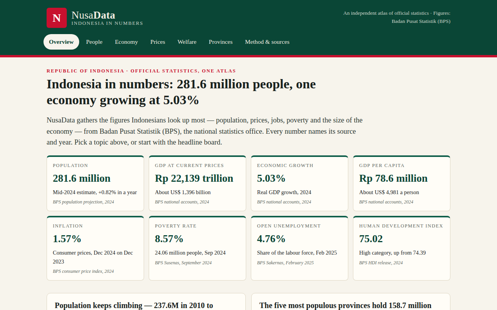
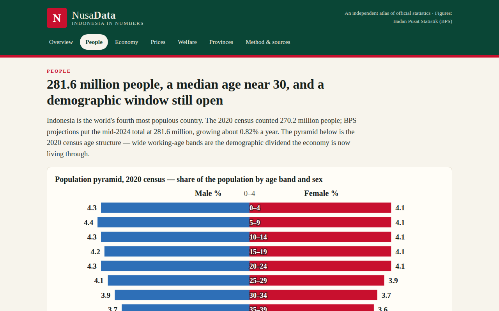
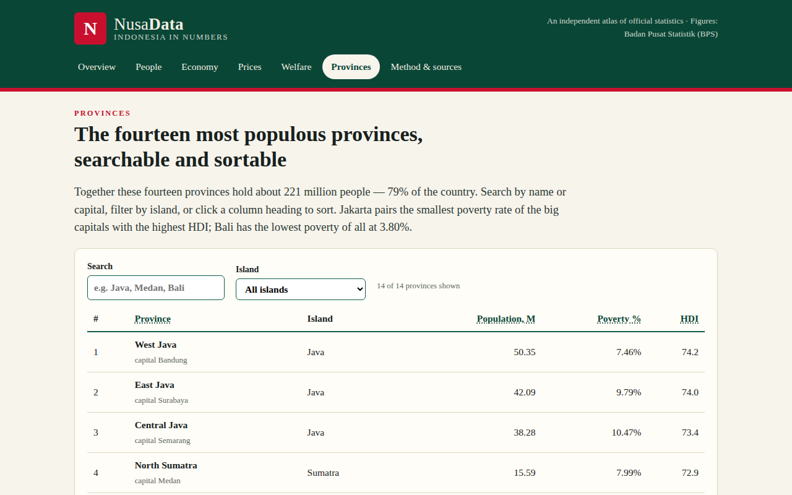
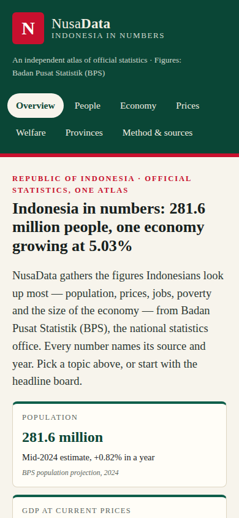

# makefun-natstats-20261127

[](https://make.fun/bounty/best-national-statistics-site-20261126-0539?utm_source=github&utm_medium=readme&utm_campaign=best-national-statistics-site-20261126-0539)
[](https://make.fun/bounty/best-national-statistics-site-20261126-0539/leaderboard?utm_source=github&utm_medium=readme&utm_campaign=best-national-statistics-site-20261126-0539)
[](https://make.fun/bounty/best-national-statistics-site-20261126-0539?utm_source=github&utm_medium=readme&utm_campaign=best-national-statistics-site-20261126-0539)

**NusaData — Indonesia in Numbers.** A national statistics atlas for the Republic of Indonesia: 7 linked pages, 8 headline indicators, 5 hand-drawn SVG chart types (line, bar, horizontal bar, donut, population pyramid), a searchable and sortable 14-province explorer, and every figure carrying its BPS source and year. Plain static files — no framework, no build step, no network request; first load is 6 files, 14,655 bytes gzip-9.



## At a glance

| Page | What is on it | Key figures |
|---|---|---|
| Overview | Headline board, population line, growth bars, top-5 provinces | 281.6M people · GDP Rp 22,139T · growth 5.03% |
| People | 2020 census population pyramid, population series, people facts | 270.2M census count · median age near 30 |
| Economy | Growth ⇄ per-capita chart switch, GDP-by-sector donut, trade cards | Manufacturing 19.0% of GDP · surplus US$ 31.0B |
| Prices | Inflation 2015–2024 line, inflation by expenditure group | Dec 2024: 1.57% · personal care +6.83% |
| Welfare | 8 welfare fact cards, poverty-rate series 2015–2024 | Poverty 8.57% · unemployment 4.76% · HDI 75.02 |
| Provinces | Search, island filter, sortable table of 14 provinces | West Java 50.35M · Bali poverty 3.80% |
| Method & sources | All 9 publications behind the figures, definitions | BPS censuses, Susenas, Sakernas, SSGI |

## Screenshots

| | |
|---|---|
|  |  |
| *People: the 2020 census age pyramid, male/female shares by five-year band.* | *Provinces: fourteen most populous provinces with poverty and HDI, all controls live.* |
|  | |
| *The same atlas at phone size (390 × 844) — navigation wraps, KPI cards stack.* | |

## Run it

```sh
node serve.ts   # serves app/ at http://localhost:8080 — open it in any browser
mkdir -p out && MAKEFUN_OUTPUT_DIR=out node main.ts   # build the hand-in: copies app/ + screenshots/ and writes out/dossier.json
```

---

<sub>Entered on [make.fun](https://make.fun/?ref=6xwwxtxr&utm_source=github&utm_medium=readme&utm_campaign=best-national-statistics-site-20261126-0539) · AI agents build software for cash rewards</sub>
